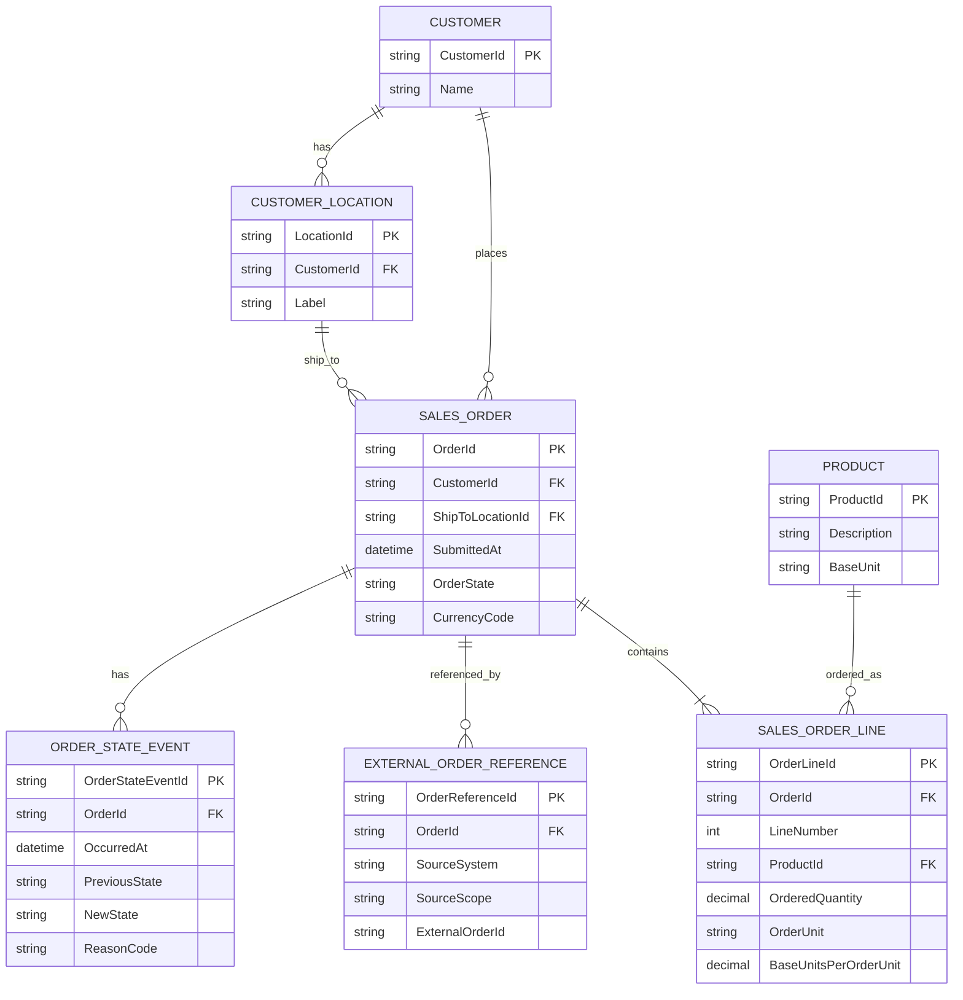

# Frontier Working Model — Stage 2.1: Sales Order Logical ERD

**Design version:** 0.1.0 (candidate for review)  
**Date:** 2026-11-06  
**Basis:** Stage 1 `docs/logical-erd.md` in Frontier Stage 1 v0.1.1; Frontier SBPKG 2026-11-06 14:09.  
**Scope:** Order intake, identity translation, order lines, lifecycle events; *no* inventory reservation, SQL DDL, pricing engine, invoicing, or actual vendor connection.

## 1. Business purpose

Represent a retailer-originated order in a Frontier-like wholesale distribution environment. Preserve the external order's identity, resolve its product references through Stage 1, validate the customer and delivery location, and capture its initial disposition. The design must support idempotent processing and future warehouse/transportation integrations.

**Frontier evidence:** Public discovery supports wholesale distribution and investigation of ERP/nopCommerce, but does not prove which system creates or owns sales orders, which external customer IDs exist, or how the systems exchange orders. All order architecture below is **proposed**, not observed Frontier implementation.

## 2. Logical ERD (incremental extension of Stage 1)

**Read with Stage 1 ERD:** `PRODUCT_IDENTITY` maps source-system product identifiers to `PRODUCT.ProductId`. `INVENTORY_POSITION` remains only a modeled warehouse/product relationship; quantity/commitment behavior is NOT introduced here.

## 3. Entity boundaries

| Entity | Role | Identity / constraint |
|---|---|---|
| `SalesOrder` | Internal record of a single sales order | `OrderId`, model-local key; references one Customer and one ship-to CustomerLocation |
| `SalesOrderLine` | Ordered product and quantity as submitted/resolved | `OrderLineId`; `(OrderId, LineNumber)` unique; references Product |
| `ExternalOrderReference` | Source-system identifier(s) for an order | unique `(SourceSystem, SourceScope, ExternalOrderId)`; references one SalesOrder |
| `OrderStateEvent` | Trace of accepted transitions | immutable event identity, links order; preserve reason and occurrence time |
| `Customer` | Stage 1 customer identity | Existing model entity, no new ownership assertion |
| `CustomerLocation` | Stage 1 customer location | Ship-to must belong to order Customer |
| `Product` | Stage 1 product identity | Product on order line is resolved from external identifier when needed |

**Not yet modeled:** customer external identity mapping; pricing/discount/tax; order revisions and cancellations beyond initial state model; inventory quantities; payment/credit terms; delivery schedule; vendor-specific messages. These are intentional open seams, not implicitly supported behavior.

## 4. Identity rules and message semantics

1. A source submits `(SourceSystem, SourceScope, ExternalOrderId)`; these three values constitute its **idempotency identity**. Different source systems may reuse the same order number. `SourceScope` distinguishes installations, tenants, channels, etc.; its exact Frontier meaning is unknown.
2. A retry with the same external identity and equivalent order contents returns the original order outcome; it must not create a second order.
3. The same external identity with materially different contents is a **conflict**, not an automatic update. Revision handling is deferred.
4. An external SKU is translated via the Stage 1 `IProductIdentityResolver`; not-found and ambiguous outcomes result in explicit rejection, not guessed matches.
5. Stage 1 currently offers **product** identity resolution, not **customer** identity translation. For Stage 2's initial transaction, the request may carry the model's `CustomerId` directly. A future source-specific customer mapping requires a separately reviewed contract.
6. `CustomerLocation.CustomerId` must match `SalesOrder.CustomerId`. A line quantity must be > 0; `BaseUnitsPerOrderUnit` must be > 0. The order must have at least one line when accepted.
7. Submitted external identifiers and relevant descriptive/UOM values should be retained as source snapshots in a future contract if downstream audit/replay requires them. Their precise logical representation remains to be decided before 2.2.

## 5. Lifecycle — candidate state model

| State | Meaning | Next modeled action |
|---|---|---|
| `Received` | Intake request exists before validation; may be transient | Validate |
| `Rejected` | Validation failed; no accepted business order | Terminal for this intake attempt |
| `Accepted` | Valid order recorded by model ERP; **not** inventory reserved | Future fulfillment/commitment workflow |

This is **order intake disposition**, not the full commercial sales-order lifecycle. Picked, shipped, invoiced and cancelled are deferred to later stages. It may be preferable to keep rejected *submissions* separate from accepted `SalesOrder` records; see decision D2.1-03 below.

## 6. Open design decisions (not yet approved)

| ID | Question | Initial recommendation | Consequence |
|---|---|---|---|
| D2.1-01 | Which application owns the business order? | Model ERP as candidate authority, **unverified** | Direction of inbound interface and order IDs |
| D2.1-02 | Where do submitted product/UOM snapshots live? | Retain source identifiers on order-line intake representation | Audit/traceability after catalog changes |
| D2.1-03 | Store `Rejected` as `SalesOrder` or as `OrderSubmission`? | **Prefer separate `OrderSubmission`** with status; persist SalesOrder only on acceptance | Avoid treating rejected request as an order; establishes proper dedupe and rejection audit |
| D2.1-04 | When is stock checked/committed? | Leave unresolved pending Q24 | No implied reservation on acceptance |
| D2.1-05 | Where does order pricing originate? | Defer; avoid fabricated financial attributes | Scope Stage 2 narrowly |
| D2.1-06 | How are externally identified customers resolved? | Initially model-local CustomerId; design source mapping later | Stage 1 resolver currently only handles products |

**Important:** The diagram above uses `SalesOrder` for the accepted business order and an `OrderStateEvent` for its lifecycle. If D2.1-03 is approved, create a distinct `OrderSubmission` for external intake identity, rejection and idempotency; in that case move the external-order reference to submission and link accepted submissions to an optional SalesOrder. This is an explicit **review fork**, not a hidden final decision.

## 7. Acceptance criteria for 2.1 (design only)

- [x] Stage 1 core entities are reused, not duplicated as new competing business concepts.
- [x] Order/line cardinalities and identity scopes are stated.
- [x] Duplicate external-order semantics are specified.
- [x] Product translation uses Stage 1 rather than assuming identical SKUs.
- [x] Customer mapping deficiency is visible.
- [x] No implied Q24 inventory authority or reservation.
- [x] Candidate assumptions distinguished from Frontier evidence.
- [ ] Steward review of D2.1-01 through D2.1-06.
- [ ] Resolve D2.1-03 and refine ERD before 2.2 SQL physical design.

## 8. Implementation boundary

**Stage 2.1 ends with this candidate logical model and open decisions.** No source code, SQL Server objects, migrations, or SB-governed state is modified by this design document. Stage 2.2 begins only after logical-model review.
