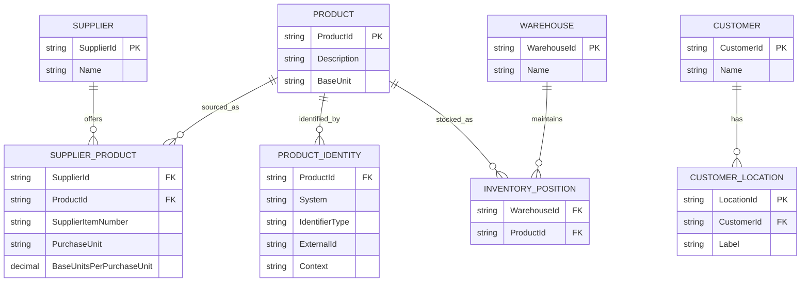

# Frontier Stage 1 — Logical ERD v0.1 (candidate)

## Logical modeling decisions
- A product has a model-local canonical `ProductId`; this is NOT asserted as Frontier's data architecture.
- External identifiers are scoped by `System` + `IdentifierType` + optional `Context`, never globally by SKU alone.
- Source ambiguity is represented explicitly instead of selecting an arbitrary match.
- SupplierProduct models supplier-specific SKU and unit conversion; receiving and costing remain out of scope.
- InventoryPosition denotes a relationship only, without quantities or ownership decisions (Q24 remains unresolved).
- Identity validity dates and versioning are deferred pending evidence of required lifecycle semantics.
- This logical ERD does not imply tables, databases, application ownership, or service topology.

## Open questions
1. Which actual systems assign product, supplier, customer and warehouse identifiers?
2. How are UOM, product variants and supplier packaging represented?
3. Is the ERP's item ID distinct from nopCommerce's product ID and SKU?
4. Does warehouse execution use separate item reference codes?
5. What is the system of record for the product catalog and cross references?
